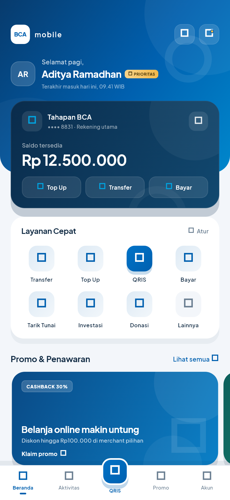
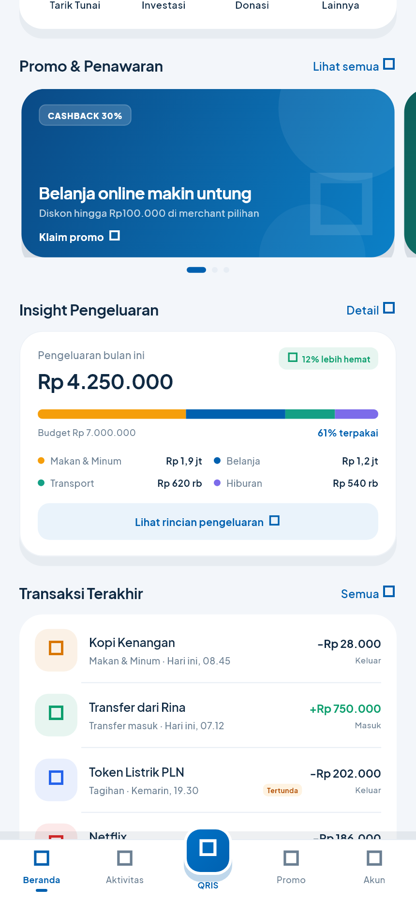
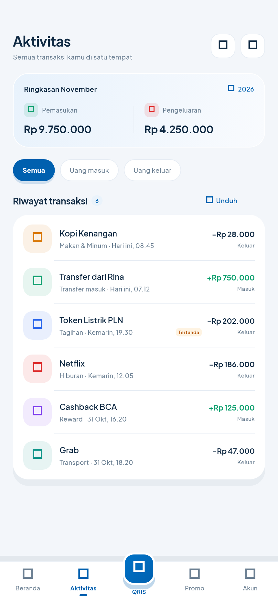
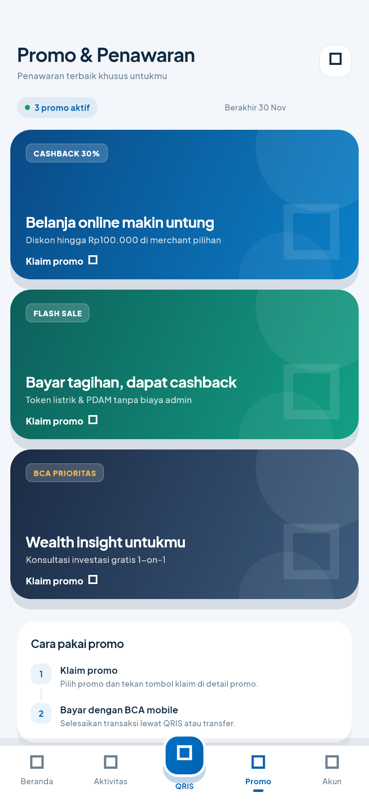
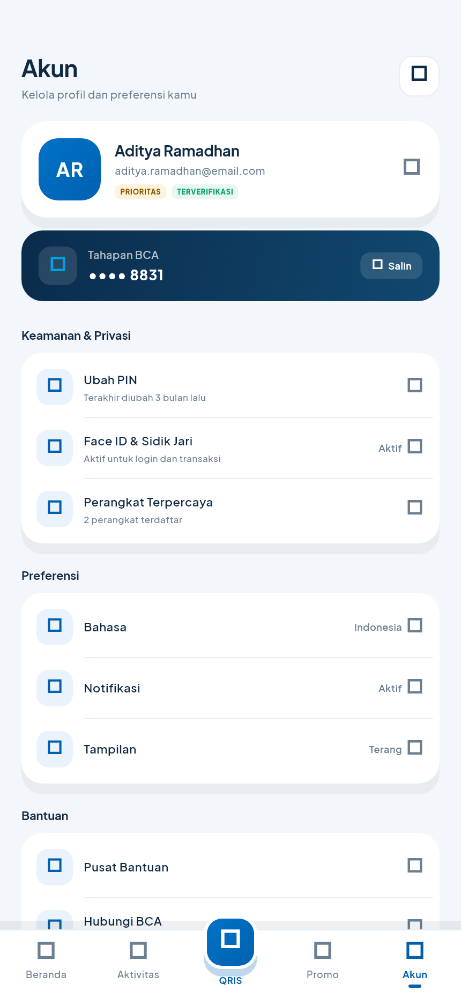
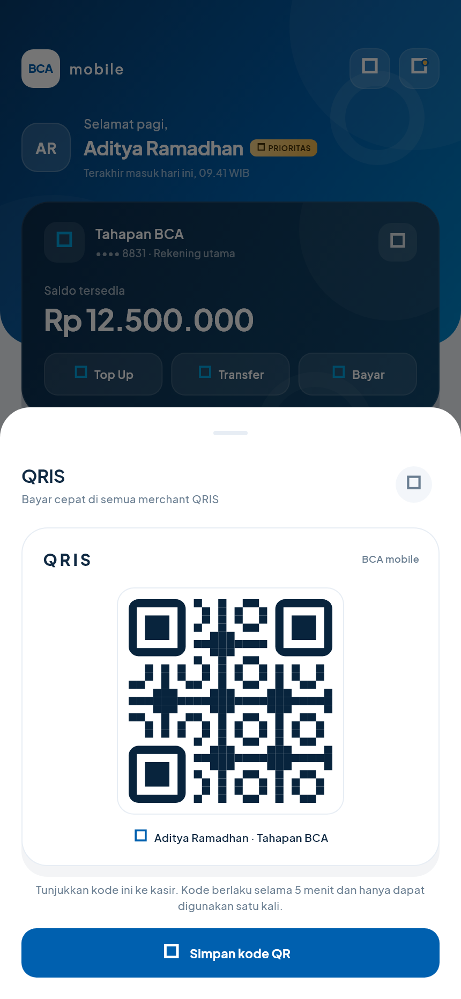

# BCA mobile — Redesign · Flutter

> Konsep desain ulang halaman utama aplikasi **BCA mobile** menggunakan Flutter.
> Dibuat sebagai studi UI/UX dan portofolio — bukan aplikasi resmi BCA.


Repositori: [github.com/lismaayanti19-debug/bca-mobile-redesign](https://github.com/lismaayanti19-debug/bca-mobile-redesign)


<p align="center">
  
</p>

## ✨ Tentang redesign

Halaman utama BCA mobile dirancang ulang dengan pendekatan **modern minimal**:
identitas biru BCA dipertahankan, tetapi hierarki informasi dibuat lebih jelas,
kartu saldo dibuat lebih premium, dan aksi-aksi utama ditempatkan dalam jangkauan
jempol. Semua data yang tampil adalah data dummy.

**Yang berubah dari tampilan konvensional:**

- Header gradien biru dengan sapaan personal, badge Prioritas, dan akses cepat ke notifikasi.
- Kartu saldo navy yang melayang di antara header dan konten, lengkap dengan toggle privasi saldo.
- Delapan layanan cepat dalam satu kartu, dengan QRIS sebagai aksi utama.
- Carousel promo dengan indikator halaman dan detail promo.
- Insight pengeluaran bulanan: total, progres budget, dan komposisi kategori.
- Daftar transaksi terakhir yang bisa dibuka untuk melihat detail dan bukti transaksi.
- Bottom navigation custom dengan tombol QRIS melayang.
- Halaman Aktivitas, Promo, dan Akun yang fungsional — bukan sekadar placeholder.
- Bottom sheet untuk QRIS, notifikasi, semua layanan, detail promo, dan detail transaksi.

## 📱 Tampilan

| Beranda | Transaksi & insight | Aktivitas |
| :---: | :---: | :---: |
|  |  |  |

| Promo | Akun | QRIS |
| :---: | :---: | :---: |
|  |  |  |

## 🧩 Fitur

- **Privasi saldo** — sembunyikan/tampilkan saldo dengan animasi.
- **Pull to refresh** — indikator refresh dan snackbar konfirmasi.
- **Layanan cepat** — 8 aksi dengan feedback haptic dan animasi tekan.
- **Promo carousel** — geser kartu, indikator aktif, dan sheet detail promo.
- **Insight pengeluaran** — grafik komposisi kategori dan progres budget.
- **Transaksi** — daftar transaksi masuk/keluar, status tertunda, dan sheet detail.
- **QRIS** — kode QR yang digambar dengan `CustomPainter`, tanpa aset gambar.
- **Filter aktivitas** — Semua / Uang masuk / Uang keluar.
- **Responsif** — diuji pada lebar 320–768 px dan text scale 1.2.
- **Tanpa dependency runtime tambahan** — hanya Flutter SDK; font dibundel lokal.

## 🎨 Design system

**Warna**

| Token | Hex | Penggunaan |
| --- | --- | --- |
| BCA Blue | `#0060AF` | Aksi utama, brand, indikator aktif |
| Sky | `#00A3E0` | Aksen ikon pada kartu gelap |
| Navy | `#08243D` | Kartu saldo, snackbar, teks kuat |
| Background | `#F3F6FA` | Kanvas halaman |
| Ink | `#102A43` | Teks utama |
| Muted | `#6B7F92` | Teks sekunder |
| Success | `#0E9F6E` | Uang masuk, status berhasil |
| Gold | `#F2B84B` | Badge Prioritas |

**Tipografi** — [Plus Jakarta Sans](https://github.com/tokotype/PlusJakartaSans) (400–800),
dibundel di `assets/fonts` dengan lisensi SIL Open Font License.

**Bentuk & elevasi** — radius kartu 20–26 px, tombol 12–17 px, shadow navy
beropasitas rendah (`0x0D0B2A45`), dan spacing berbasis kelipatan 8.

## 🚀 Menjalankan

Prasyarat: Flutter 3.35+ dan Dart 3.9+.

```bash
git clone https://github.com/lismaayanti19-debug/bca-mobile-redesign.git
cd bca-mobile-redesign
flutter pub get

# Web (paling cepat untuk melihat hasilnya)
flutter run -d chrome

# Android
flutter run -d android

# Windows (jendela 460 × 932, menyerupai layar ponsel)
flutter run -d windows
```

Build produksi:

```bash
flutter build web --release
flutter build apk --release
```

## 🧪 Test & screenshot

```bash
flutter analyze
flutter test
```

Test mencakup format rupiah, render halaman utama, toggle saldo, navigasi,
filter transaksi, serta smoke test responsif di lima ukuran layar.

Screenshot di README dihasilkan dari golden test dengan font asli:

```bash
flutter test tool/screenshots/screenshot_test.dart --update-goldens
```

File PNG ditulis ke `tool/screenshots/goldens/`. Salin ke `docs/screenshots/`
jika ada perubahan tampilan.

## 📂 Struktur project

```text
lib/
├── app.dart
├── main.dart
├── core/
│   ├── theme/               # warna & ThemeData
│   └── utils/               # format rupiah
├── data/
│   ├── models/              # promo, transaksi, quick action, kategori
│   └── sample_data.dart     # data dummy
├── features/
│   ├── home/                # halaman utama + widget + bottom sheet
│   ├── activity/
│   ├── promo/
│   ├── account/
│   └── shell/               # IndexedStack + bottom navigation
└── shared/
    └── widgets/             # press scale, section header
```

## ☁️ CI & demo web

- `.github/workflows/ci.yml` — format check, analyze, dan test di setiap push/PR.
- `.github/workflows/deploy-web.yml` — build web dan deploy ke GitHub Pages.

Untuk mengaktifkan demo: buka **Settings → Pages → Build and deployment →
Source: GitHub Actions**, lalu jalankan workflow. Demo akan tersedia di
https://lismaayanti19-debug.github.io/bca-mobile-redesign/

## ⚠️ Disclaimer

Project ini adalah **konsep desain ulang independen** untuk keperluan edukasi dan
portofolio. Tidak berafiliasi dengan, disponsori oleh, atau diakui oleh
PT Bank Central Asia Tbk. Nama, logo, dan merek BCA adalah milik pemiliknya
masing-masing. Seluruh nominal, nama nasabah, promo, dan transaksi adalah data
fiktif. Jangan menggunakan project ini untuk transaksi keuangan nyata.

## 📄 Lisensi

Kode dirilis di bawah [MIT License](LICENSE). Font Plus Jakarta Sans menggunakan
[SIL Open Font License 1.1](assets/fonts/OFL.txt).
